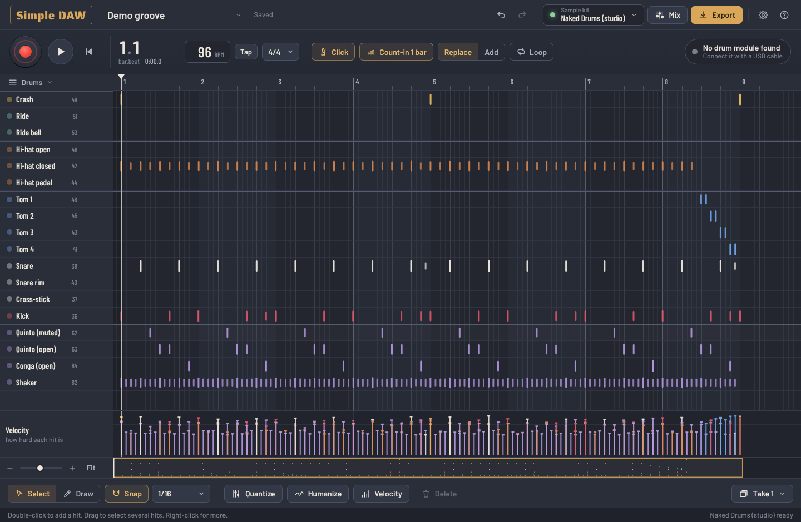
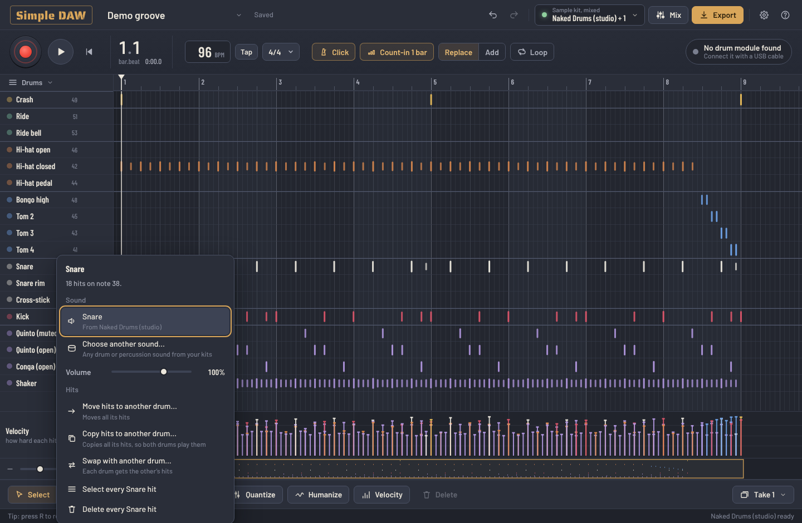
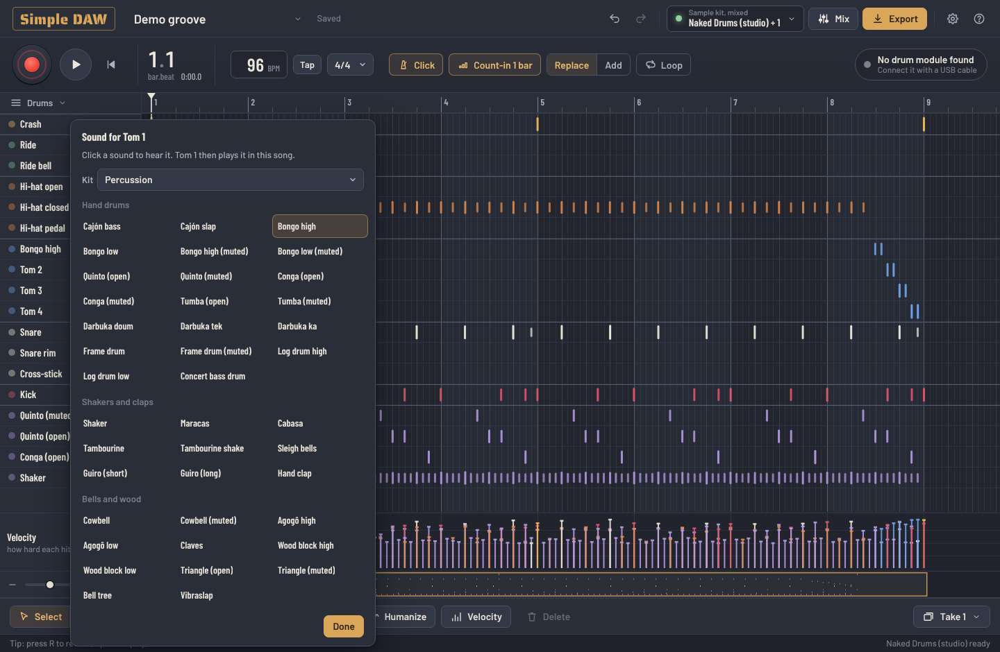

# Simple DAW

A small, friendly recording app for electronic drums on Windows. Record your kit as MIDI, then hear it back through realistic sampled kits, with no repeated "machine-gun" hits.

## What it does

- **Records your e-drums** over USB MIDI with a count-in and click. Every recording is kept as its own take.
- **Plays them back with real sampled kits.** Each hit picks from several recordings at the right loudness, so a snare roll sounds like a drummer, not a loop. Free kits download from inside the app: Naked Drums, Muldjord Kit, DRS Kit and Percussion.
- **Percussion:** cajón, bongos, congas, shaker, tambourine, cowbell, agogô, triangle and more. Pick it as your kit and your pads play it, or put percussion next to your drums.
- **Mix and match kits:** any drum can borrow a sound from any kit, like a tom from another kit or a conga from Percussion.
- **Pick one variation per drum:** sample kits record each drum several times. Use them all (at random or in turn), or lock a drum to the one recording you like.
- **Save your kit setup** with its borrowed sounds, chosen variations, drum volumes and kit mixer, and pick it in any song from Sound › My kits.
- **Move, copy or swap hits between drums**, for example to turn a snare part into a conga part.
- **Edit like a normal DAW:** draw and delete hits, quantize, humanize, change velocity, loop a part, undo everything, import MIDI and add a backing track.
- **Exports** WAV and MIDI files.
- **Hosts VST2 and VST3 plugins** (64-bit). Synth plugins work; some drum plugins, like MT Power Drum Kit and Steven Slate Drums, stay silent.

## What you need

- Windows 10 or 11
- [Python](https://www.python.org/downloads/) 3.11, 3.12, 3.13 or 3.14 (3.12 is a safe choice)
- Microsoft Edge or Google Chrome (Edge comes with Windows)
- An electronic drum kit or module with USB MIDI. You can also draw hits or import MIDI files without one.

## Install

1. Click **Code › Download ZIP** on this page and unzip it anywhere, for example in your Downloads folder.
2. Install Python if you don't have it yet.
3. Double-click **Start Simple DAW.bat**. The first time, it sets itself up, which needs internet and takes a minute or two. After that it opens straight away in its own window.
4. In the app, open **Sound › Get more kits…** and download a kit, such as Naked Drums or Percussion.

To update, download the new ZIP and copy it over your folder. Your songs, exports and kits stay where they are.

## Using it

1. Plug your drum module in with USB and turn it on. If the window asks to use MIDI devices, click **Allow**.
2. Hit a pad and its lane lights up. Press **R** to record and **Space** to play it back.
3. Pick the sound in **Sound**. Right-click any drum name to move or copy its hits, change its volume or give it a sound from another kit.

There's more in [How to use Simple DAW.txt](How%20to%20use%20Simple%20DAW.txt) and in the app under **Help** (press **?**).

| The menu for each drum | Borrow a sound from any kit |
| --- | --- |
|  |  |

## Folders

Simple DAW creates these next to the launcher the first time it runs:

- `Projects`: your songs (they save themselves)
- `Exports`: WAV and MIDI files you export
- `Kits`: downloaded sample kits. Any other SFZ kit you unzip here shows up too.
- `app/data`: settings and the log file (`simple-daw.log`)

## How it's built

- `app/server.py` is a small local web server. It opens the interface in an Edge or Chrome app window and saves songs, settings and exports.
- `app/engine_worker.py` runs in its own process, so a plugin that crashes can't take the app down. It hosts VST plugins with [DawDreamer](https://github.com/DBraun/DawDreamer) and plays SFZ kits.
- `app/sfz.py` is the SFZ kit player (round robins, velocity layers, mic mixing, hi-hat pedal, several kits at once).
- `app/web` is the interface: plain JavaScript modules and canvas drawing, with no build step.
- `app/kitdefs/percussion` holds the Percussion kit's mapping. `tools/make_percussion_kit.py` builds it from the VCSL samples.

## Credits and licenses

Simple DAW is free software under the GNU General Public License v3.0 (see [LICENSE](LICENSE)).

- Built-in kits: AVL Drumkits by Glen MacArthur, CC BY-SA 3.0 (included in `app/kits/avl`)
- Percussion samples: Versilian Community Sample Library (VCSL) by Versilian Studios, CC0, downloaded when you ask for them
- Naked Drums by Wilkinson Audio; Muldjord Kit and DRS Kit by the DrumGizmo team; SFZ versions by kinwie. All CC BY 4.0, downloaded when you ask for them.
- Plugin hosting: DawDreamer (GPLv3)
- Typefaces: Barlow and Saira Stencil One, SIL Open Font License (included in `app/web/fonts`)

More detail is in [THIRD-PARTY-NOTICES.md](THIRD-PARTY-NOTICES.md).
